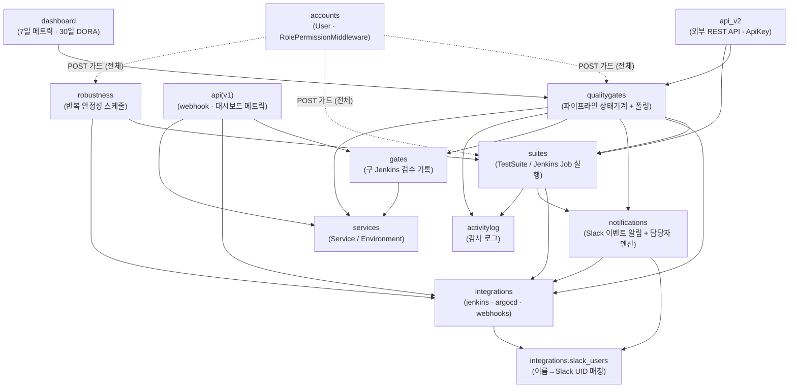
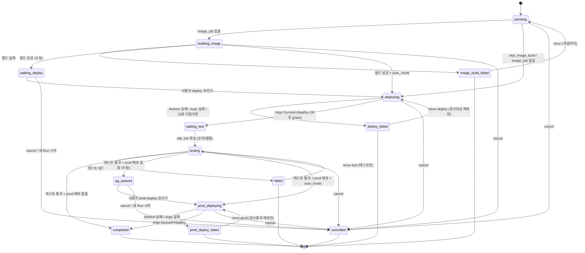
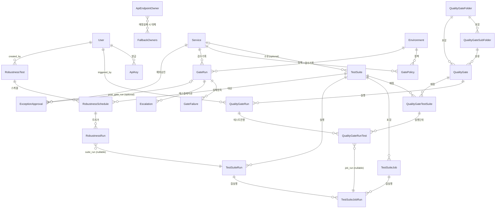

# QA Quality Gate Portal — 시스템 소개 (intro.md)

> Jenkins · Argo CD · Test Suite 를 하나의 검수 파이프라인으로 묶어 운영하는 Django 기반 품질 게이트 포털.
> 접속 주소: <https://qw.jkintra.net/qg/> (게이트웨이, IDC `wx-qms221`) · 프로그램 호출(API Key) 전용 `https://qw.jkintra.net/qg/ci-api/`. 이전 운영 도메인 `qualitygate.jkintra.net`(AWS 원본)은 2026-10 서버 이관으로 종료.
>
> 이 문서는 시스템 전체를 처음 보는 사람을 위한 **소개 + 구조도** 다. 코드 변경 가이드는 `maintenance.md`, 운영/기능 상세는 `README.md`, 기획 의도는 `PRD.md` 를 참고.

## 목차
1. 개요
2. Quality Gate 파이프라인 생명주기
3. 시스템 구조 한눈에 보기
4. 시스템 아키텍처 & 런타임
5. 도메인 모델
6. 앱(App)별 기능 카탈로그
7. 외부 시스템 연동
8. 알림 & 담당자 자동 매칭
9. 견고성(Reliability) 테스트 & 대시보드(DORA)
10. 인증·권한 & API
11. 프론트엔드 / UI
12. 디렉터리 구조 & URL 라우팅 맵
13. 실행 / 개발 환경 · 용어집 · 문서 인덱스

---


## 1. 개요

**QA Quality Gate Portal** 은 Jenkins · Argo CD · Test Suite 를 하나의 품질 관문(Quality Gate) 실행으로 엮어, QA 검수 파이프라인을 한 화면에서 트리거 · 조회 · 제어하는 사내 Django 포털이다. 그동안 Slack · Jenkins · Notion 에 흩어져 있던 QG 운영 정보를 단일 포털로 통합하는 것을 목표로 하며, QPE(품질 엔지니어링) 조직과 각 트라이브 개발자가 배포 전 검수 흐름을 셀프서비스로 운영하도록 돕는다. 접속 주소는 **https://qw.jkintra.net/qg/** (사내망 게이트웨이 `qw.jkintra.net` 경유, 서버는 IDC `wx-qms221`) 이며, 이전 운영 도메인 `qualitygate.jkintra.net`(AWS 원본·ALB)은 2026-10 서버 이관으로 종료됐다. 로컬 dev 는 `runserver 0.0.0.0:8601` 로 띄운다.

### 무엇을 하는가 — 하나의 Quality Gate Run

하나의 `QualityGateRun` 은 다음 4단계를 순서대로 진행한다 (단계는 게이트 설정에 따라 선택적으로 생략 가능).

1. **이미지 빌드** — Jenkins `image_job_path` 트리거 → 빌드 결과 폴링 (`skip_image_build` / image job 미설정 시 건너뜀)
2. **검수대상 배포 + Argo CD** — Jenkins `deploy_job_path` 배포 → Argo CD sync/health 가 Synced+Healthy 도달할 때까지 확인 (Pod 단위 검증 + 30초 grace)
3. **Test Suite 실행** — 게이트에 매핑된 `TestSuite` 들을 순차 또는 병렬로 실행 (`parallel_test`)
4. **검수통과 배포 + Argo CD** — `prod_job_path` 배포 → Argo CD 재확인 (prod 배포가 정의된 게이트만)

### 게이트 타입 — Dev→Stg / Stg→Prd

`QualityGate.gate_type` 은 생성 시 한 번 정해지며 **이후 변경 불가** (자격증명 매핑이 달라지기 때문). 타입에 따라 각 배포 단계가 사용할 Jenkins 자격증명과 Argo CD 환경이 자동 결정된다.

| gate_type | 검수대상 배포(deploy) 환경 | 검수통과 배포(prod) 환경 | auto_mode |
|-----------|-------------------------|-------------------------|-----------|
| `dev_stg` (Dev→Stg) | Dev | Stg | 사용 가능 |
| `stg_prd` (Stg→Prd) | Stg | Prd | no-op (토글 미노출) |

- 자격증명은 인스턴스 단위인 `QualityGateFolder` 에 모여 저장된다 — `dev_jenkins_*` / `prod_jenkins_*`, `dev/stg/prd_argocd_token`. 여러 게이트가 같은 Folder 를 공유해 중복 저장을 피한다.
- `status_display` 가 gate_type 에 맞춰 환경 라벨(Dev/Stg/Prd)을 동적으로 매핑하므로, 관리자가 enum 의 generic 명칭에 혼동되지 않는다.

### 핵심 가치

- **단일 포털 통합** — 분산된 QG 운영 정보(빌드 · 배포 · 테스트 · 알림 · 담당자)를 한 곳에서 관리.
- **실시간 상태 추적** — htmx 5초 폴링 + `qg_notify.js` 글로벌 와처 + Service Worker OS 알림으로, 다른 탭 · 다른 화면에 있어도 Run 완료/실패를 놓치지 않음.
- **자동 진행 + 수동 게이트의 균형** — `auto_mode` 로 Dev→Stg 를 끝까지 자동 진행하거나, 단계마다 사용자 확인을 거치는 수동 게이트로 운영.
- **외부 자동화 연동** — `/api/v2/` REST API(ApiKey 인증 + Scope + Rate limit)로 외부 CI/CD 가 Run 을 트리거 · 폴링 · 제어.
- **실패 추적 자동화** — 실패 시 Jenkins 콘솔에서 에러 URL 을 추출해 API 담당자(FE/BE)를 자동 매칭하고 Slack 멘션 발송.

## 2. Quality Gate 파이프라인 생명주기

`QualityGateRun` 은 14개 상태를 거치며, 핵심 로직은 `apps/qualitygates/services.py` (트리거/취소/재실행)와 `apps/qualitygates/views.py` (폴링 루프)에 나뉘어 있다. 전체 상태 전이 다이어그램은 **§3.3** 을 참조한다 (여기서는 단계별 의미와 운영 규칙만 다룬다).

### 4단계 ↔ 상태값 매핑

| 단계 | 상태값 | 의미 | 폴링/전이 함수 |
|------|--------|------|----------------|
| (시작) | `pending` | Run 생성 직후 초기 상태 | `trigger_gate_run()` |
| ① 이미지 빌드 | `building_image` | Jenkins `image_job_path` 빌드 중 | `_poll_image_build()` |
| | `image_build_failed` | 이미지 빌드 실패 **(터미널)** | |
| ② 검수대상 배포 | `waiting_deploy` | 이미지 완료 후 사용자 deploy 입력 대기 | `deploy_trigger` (POST) |
| | `deploying` | Jenkins 배포 + Argo CD sync 확인 중 | `_poll_deploy()` + `_check_argocd_sync("deploy")` |
| | `deploy_failed` | Jenkins/Argo 실패 또는 15분 타임아웃 **(터미널)** | |
| ③ Test Suite | `waiting_test` | 배포 완료, 테스트 시작 대기 (idle Job 확보 전) | `_advance_test()` |
| | `testing` | TestSuite 순차/병렬 실행 중 | `_poll_current_test()` |
| | `failed` | 테스트 실패 **(터미널)** | `_finalize_run()` |
| ④ 검수통과 배포 | `qg_passed` | 테스트 통과, prod 배포 사용자 입력 대기 (prod 배포 있는 게이트) | `prod_deploy` (POST) |
| | `prod_deploying` | Jenkins prod 배포 + Argo CD 재확인 중 | `_poll_prod_deploy()` + `_check_argocd_sync("prod")` |
| | `prod_deploy_failed` | prod 배포 실패 **(터미널)** | |
| (완료) | `completed` | 전체 완료 **(터미널)** | `_finalize_run()` |
| (취소) | `cancelled` | 사용자 취소 또는 새 Run 시작에 의한 자동 취소 **(터미널)** | `cancel_run()` |

- 테스트 통과 후 **prod 배포가 없는 게이트**(`has_prod_deploy=false`)는 `qg_passed` 를 건너뛰고 바로 `completed` 로 종료된다.
- `image_stage_present` 는 `gate.image_job` 정의 여부가 아니라 **Run 의 `image_started_at` 유무**로 판단한다 — 사용자가 `skip_image_build` 로 실행한 Run 은 이미지 단계 카운트에서 제외.

### auto_mode (자동 진행 — Dev→Stg 한정)

`auto_mode` 가 켜지면 사용자 입력 대기 상태(`waiting_deploy`, `qg_passed`)를 건너뛰고 다음 단계를 자동 트리거한다. **Dev→Stg 게이트에서만 의미가 있고**, Stg→Prd 게이트에서는 `gate_toggle_auto` 뷰가 gate_type 을 검사해 토글 자체를 노출하지 않는다 (기술적 no-op).

- 이미지 성공 → `_auto_trigger_deploy()` 가 `deploying` 으로 직진.
- 테스트 성공 → `_auto_trigger_prod()` 가 `prod_deploying` 으로 직진.
- 파라미터가 비어 있으면 `_collect_default_params(prefer_release_branch=True)` 로 Jenkins 기본값을 수집하고, **Git Parameter 의 `release/release_*` 브랜치를 우선 default** 로 선택 (여러 개면 사전순 가장 큰 = 가장 미래 일자).
- **APP_IMAGE 매칭 실패 시 fallback**: `_auto_trigger_deploy` 는 `waiting_deploy` 로, `_auto_trigger_prod` 는 `qg_passed` 로 떨어뜨려 사용자 모달 확인을 강제한다 — 빈 `APP_IMAGE` 를 그대로 넘기면 Jenkinsfile `params.X` 언바인딩으로 `MissingPropertyException` 이 발생하기 때문 (2026-05-11 Run #14/public-auth 사고).
- 단, `DEPLOYER_REFS=refs/heads/master` 같은 **String 타입 Git Parameter 는 의도적으로 치환하지 않는다** — Jenkinsfile 저장소 ref 를 가리키므로 release 브랜치로 바꾸면 fetch 가 실패한다.

### parallel_test (병렬 / 순차, 기본 Off)

`QualityGate.parallel_test` 토글로 게이트에 매핑된 TestSuite 들의 실행 방식을 결정한다. 기본값은 Off(순차).

- **순차 (Off)**: `current_suite_index` 번째 Suite 만 트리거 → 통과하면 `index++` 후 다음 Suite. `current_suite_index` = **다음 실행 대상 위치**.
- **병렬 (On)**: `_advance_test_parallel()` 가 `pending`/`waiting` Suite 를 한 번에 모두 트리거하고, 전부 끝날 때까지 대기. 이때 `current_suite_index` = **완료 카운트** (의미가 다름).
- `total_suites` 는 Run 생성 시점에 고정되지 않고 `_compute_section_counts()` 가 현재 `gate_suites` 로 실시간 재계산한다 — 게이트에서 Suite 가 삭제되면 cascade 로 `test_runs` 가 줄어들 때 '3/3 → 2/3' 같은 역행 진도 표시를 방지.

### rerun 3종 (부분 재실행)

실패한 단계만 골라 재실행할 수 있어 앞선 단계의 산출물을 재사용한다. 새 Run 을 만드는 전체 재실행(`rerun_gate`)과 구분된다.

| 재실행 종류 | 서비스 함수 | 재사용 | 시작 상태 | 전제 조건 |
|------------|-------------|--------|-----------|-----------|
| 테스트만 재실행 | `rerun_test()` | 이미지·배포 재사용 | `failed` → `testing` (`_advance_test`) | `deploy_completed_at` 있어야 함 (배포 못한 Run 은 불가) |
| 검수대상 배포만 재실행 | `trigger_deploy()` (재시도) | 이미지 재사용 | `deploy_failed` → `deploying` | deploy_build_* 초기화 후 재트리거 |
| 검수통과 배포만 재실행 | `trigger_prod()` (재시도) | 테스트·배포 재사용 | `prod_deploy_failed` → `prod_deploying` | qg 통과 이력 |

- `rerun_gate` 는 단순 redirect 뷰이고, 실제 트리거는 `services.trigger_gate_run` / `services.rerun_gate` 직호출에서 수행한다.

### Run 취소 · 중복 차단 · 일련번호

- **중복 차단**: 같은 게이트에 `ACTIVE_STATUSES`(`pending`/`building_image`/`deploying`/`waiting_test`/`testing`/`prod_deploying`)인 Run 이 있으면 새 Run 을 차단한다 — API v2 에서는 `409 Conflict` (`GateRunError(code=active_run_exists)`).
- **대기 Run 자동 취소**: 새 Run 시작 시 `WAITING_USER_STATUSES`(`waiting_deploy`/`qg_passed`)에 머물던 기존 Run 은 자동으로 `cancelled` 처리된다 (의도된 동작이나, 사용자가 모르면 "대기 중이던 Run 이 갑자기 취소됨" 혼란 가능).
- **취소**: `cancel_run()` 이 진행 중인 Jenkins 빌드(이미지/배포/테스트/prod)를 `stop_build` 로 abort 하고 `run.status=cancelled` 로 전환. `is_running` 은 `cancelled` 를 제외하므로 취소 후 폴링이 와도 상태를 다시 바꾸지 않는다.
- **일련번호 (`seq_no`)**: 게이트별로 1부터 순증가하는 번호. 시간(`created_at`)이 아닌 생성순으로 Run 을 구별하므로, 같은 게이트의 여러 Run 탭을 동시에 열었을 때 최신을 판별한다(`newer_run_for_gate` 가 `seq_no` 비교) — stale 탭에 경고 배너 노출. `seq_no=0` 은 migration 케이스(취소된 Run)용으로 unique 제약에서 제외.

### 폴링 모델

상태 진행은 서버 측 폴링 루프와 클라이언트 측 htmx 폴링이 맞물려 동작한다.

- **클라이언트(htmx)**: `run_detail.html` 이 `GET /qualitygates/runs/<pk>/status/` (`run_status_fragment`)를 **5초 간격**으로 호출 → `_run_status.html` fragment 만 갱신. `is_terminal=true` 도달 시 폴링 중단.
- **서버 폴링 루프**: 폴링 요청이 들어오면 `_poll_gate_run()` 이 현재 상태에 맞는 하위 폴러를 호출한다 — `_poll_image_build()` → `_poll_deploy()` → `_advance_test()` → `_poll_current_test()` → `_poll_prod_deploy()` → `_finalize_run()`. (호출 경로: `gate_detail`/`run_detail` 진입 시 즉시 실행, `run_status_fragment` 5초 주기, `argocd_retry` 후속 호출.)
- **Argo CD 체크 타이밍** (`_check_argocd_sync`):
  - 첫 호출에서 `get_application(refresh="hard")` + `sync_application()` 을 트리거하고 `sync_requested_at` 을 **sync 트리거 *전*** 에 기록(stale false-positive 방지), `False` 반환 → **4초 쿨다운** 후 다음 폴링부터 상태 확인.
  - **15분 타임아웃** 초과 또는 operation phase `Failed`/`Error` → `deploy_failed`/`prod_deploy_failed` (`ARGOCD_FAILED` 이벤트).
  - Synced+Healthy 도달 후 **30초 grace period** 유지 + Pod 단위 health 확인(resource-tree) → 통과해야 다음 단계로 전이. grace 중 health 가 떨어지면 `healthy_first_at` 리셋.
- **권장 폴링 간격은 5초 이상** — Argo CD 4초 쿨다운보다 짧으면 무의미하다. 응답 헤더 `X-QGP-Poll-After` 로 시스템이 권장값(terminal=0초, 진행 중=5초)을 제시한다.

## 3. 시스템 구조 한눈에 보기

### 3.1 계층 구조

```
                          ┌─────────────────────────────────────────────────┐
                          │  Browser                                        │
                          │  · htmx 5초 폴링 (#run-status fragment)         │
                          │  · qg_notify.js 글로벌 와처 (localStorage)      │
                          │  · Service Worker (/sw.js) → OS 알림 / beep      │
                          └───────────────────────┬─────────────────────────┘
                                                  │  GET /qualitygates/runs/<pk>/status/ (5초)
                                                  │  게이트웨이(HTTPS) → Django(HTTP), X-Forwarded-Proto
                                                  v
   ┌──────────────────────────────────────────────────────────────────────────────────┐
   │  Django  (runserver 0.0.0.0:8601)                                                  │
   │                                                                                    │
   │  MIDDLEWARE: Security → Session → Cors → RolePermissionMiddleware → Auth → ...      │
   │    · RolePermissionMiddleware: POST/PUT/PATCH/DELETE 3계층 가드                     │
   │      (Admin=전체 / 일반역할=실행만 / Viewer=조회만), /api/v2/* 는 우회             │
   │  DRF: /api/v1/ (webhook·메타), /api/v2/ (ApiKey 인증 + Scope + Throttle)            │
   │                                                                                    │
   │  apps/qualitygates/views.py  ── 폴링 루프 ──────────────────────────────┐          │
   │    _poll_gate_run()                                                     │          │
   │      ├─ _poll_image_build()      (BUILDING_IMAGE)                        │          │
   │      ├─ _poll_deploy()           (DEPLOYING)                             │          │
   │      ├─ _check_argocd_sync()     (4초 쿨다운 / 15분 타임아웃 / 30초 grace)│          │
   │      ├─ _advance_test()          (순차/병렬 Suite 트리거)               │          │
   │      ├─ _poll_current_test()     (TESTING)                              │          │
   │      ├─ _poll_prod_deploy()      (PROD_DEPLOYING)                        │          │
   │      └─ _finalize_run()          (QG_PASSED / COMPLETED / FAILED)        │          │
   │                                                                         │          │
   └─────────┬──────────────────┬──────────────────┬─────────────────┬──────┘          │
             │                  │                  │                 │                 │
             v                  v                  v                 v                 │
   ┌──────────────┐   ┌──────────────┐   ┌──────────────┐   ┌──────────────────┐       │
   │ Jenkins API  │   │  Argo CD API │   │  Slack API   │   │ Google Sheets API│  외부  │
   │ jenkins.py   │   │  argocd.py   │   │ (알림/멘션)  │   │ (담당자 동기화)  │  연동  │
   │ 빌드/콘솔/   │   │ sync/health  │   │ slack_users  │   │ Drive CSV export │       │
   │ 파라미터4경로│   │ pod 검증     │   │ /chat.post   │   │                  │       │
   └──────────────┘   └──────────────┘   └──────────────┘   └──────────────────┘       │
                                                                                       │
   ─────────────────────────────  사이드 저장/실행층  ──────────────────────────────────
   ┌────────────────────────┐  ┌────────────────────────┐  ┌──────────────────────────┐
   │ SQLite (db.sqlite3)     │  │ LocMemCache             │  │ Celery (eager in dev)    │
   │ 모든 도메인 모델·Run 상태│  │ Jenkins 파라미터 120초  │  │ robustness sweep,        │
   │                        │  │ Slack 사용자 1시간 캐시 │  │ poll_suite_run_status    │
   └────────────────────────┘  └────────────────────────┘  └──────────────────────────┘
```

### 3.2 앱 의존 관계



### 3.3 Quality Gate Run 상태 기계



### 3.4 핵심 도메인 모델 ER



> 비고: `ApiEndpointOwner` 는 `(method, endpoint)` unique 로 FK 관계가 없으며, URL 매칭 실패 시 singleton `FallbackOwners` 가 대체 담당자로 쓰인다 (논리적 폴백 관계). `FallbackOwners`·`OwnerSyncSettings`·`SlackNotificationSettings` 는 모두 PK=1 singleton.

## 4. 시스템 아키텍처 & 런타임

QA Quality Gate Portal 은 단일 Django 애플리케이션에 모든 도메인(파이프라인 상태기계, 테스트 스위트 실행, 외부 연동, 알림)을 담고, **서버사이드 상태 머신 + 클라이언트 5초 폴링** 으로 실시간성을 구현한다. 별도 프론트엔드 SPA 없이 Django 템플릿 + htmx 로 동작한다.

### 4.1 기술 스택

| 계층 | 채택 기술 | 비고 |
|------|-----------|------|
| 웹 프레임워크 | Django 5.x + DRF | 템플릿 렌더링 + REST API (`/api/v1`, `/api/v2`) |
| 프론트엔드 | Django 템플릿 + htmx 2.0.4 | `hx-get`/`hx-trigger` 5초 폴링, Alpine.js·Font Awesome CDN 로드 |
| DB | SQLite (dev) / PostgreSQL (production) | `db.sqlite3` 는 Git 추적 — 충돌 시 로컬본 최신 유지 |
| 캐시 | LocMemCache (dev) / Redis (production) | Jenkins 파라미터 120초, Slack 사용자 1시간 |
| 비동기 | Celery (+ celery-beat) | dev 에서는 `CELERY_TASK_ALWAYS_EAGER=True` 동기 실행 |
| 필터/직렬화 | django-filter, DRF Serializer | `GateFilter`/`SuiteFilter` 등 |
| 외부 연동 | Jenkins · Argo CD · Slack · Google Sheets | `apps/integrations/` 하위 클라이언트 |

### 4.2 실행 & 배포 토폴로지

- 로컬 dev server: `./run.sh` → `runserver 0.0.0.0:8601` (멀티스레드).
- 운영: `게이트웨이 nginx(HTTPS 종료, qw.jkintra.net/qg) → Django(HTTP, 8601)` 프록시(게이트웨이가 `/qg/` 접두를 제거, 앱은 `QGP_SCRIPT_NAME=/qg`). `SECURE_PROXY_SSL_HEADER = (HTTP_X_FORWARDED_PROTO, https)` 로 원 HTTPS 프로토콜을 인식하고 `CSRF_TRUSTED_ORIGINS` 에 `https://qw.jkintra.net` 등록(`.env` `DJANGO_CSRF_TRUSTED_ORIGINS`). 접속 주소는 `https://qw.jkintra.net/qg/`, 프로그램 호출은 `https://qw.jkintra.net/qg/ci-api/`(API Key 전용, 게이트웨이 로그인 예외). 이전 AWS 운영 주소 `qualitygate.jkintra.net`(ALB 직결)은 2026-10 서버 이관(IDC)으로 종료됐다.
- 멀티스레드 runserver 에서 SQLite 쓰기 락 + 외부 API 대기가 겹치면 요청이 밀릴 수 있어, 막힘이 길어지면 `./run.sh` 재기동.

### 4.3 설정 분기 (`config/settings/`)

`DJANGO_SETTINGS_MODULE` 로 두 갈래로 갈린다. 기본값은 `config.settings.dev` 이므로 **운영에서는 `config.settings.production` 명시 지정 필수**.

| 파일 | 역할 |
|------|------|
| `config/settings/base.py` | `INSTALLED_APPS`(13개 로컬앱 + DRF/django-filter/corsheaders/celery-beat), `MIDDLEWARE` 순서, DRF 인증/권한/throttle/exception_handler, 한국 i18n |
| `config/settings/dev.py` | SQLite, LocMemCache, CORS 전체 허용, eager Celery |
| `config/settings/production.py` | `DEBUG=False`, XSS/CSRF/HSTS/X-Frame 보안 헤더 강화 |

### 4.4 미들웨어 체인과 RolePermissionMiddleware

요청 처리 순서:

```
SecurityMiddleware → SessionMiddleware → CorsMiddleware
  → RolePermissionMiddleware (Custom) → AuthenticationMiddleware → Message/XFrame → View
```

`apps/accounts/middleware.py` 의 `RolePermissionMiddleware` 가 POST/PUT/PATCH/DELETE 요청을 3계층으로 가드한다.

- **Admin**(`is_admin=True`) → 전체 허용
- **일반 역할**(non-Viewer) → `REGULAR_POST_ALLOW` 부분문자열(`/run`, `/start/`, `/stop/`, `/rerun/` 등) 경로만 통과 = 실행 위주
- **Viewer** → `POST_ALWAYS_ALLOW`(`/accounts/logout/`, `/accounts/api-keys/`) 만 통과 = 조회 전용
- **`/api/v2/*` 는 미들웨어를 우회** → DRF 권한(`IsQPEAdmin`/`HasScope` 등)이 별도 처리하므로 api_v2 뷰는 반드시 `permission_classes` 를 명시해야 한다.

### 4.5 DRF 설정 (`/api/v1`, `/api/v2`)

- 인증: 기본 SessionAuth/BasicAuth. `/api/v2` 는 `ApiKeyAuthentication`(`apps/api_v2/authentication.py`, Bearer 토큰) + SessionAuth 이중 인증.
- 권한: 기본 `IsAuthenticated`. api_v2 는 4가지 Scope(`meta:read`/`runs:read`/`runs:trigger`/`runs:control`) 기반 `HasScope`/`CanWriteForControl`/`AdminOnlyForWildcard`. 세션 인증은 스코프 검사를 건너뛰고 역할만 검사, API Key 는 항상 스코프 검사.
- 스로틀(`apps/api_v2/throttling.py`): `ReadThrottle` 120 req/min, `WriteThrottle` 30 req/min, **API Key 단위**(캐시 키 = `api_key.pk`). 세션 인증은 throttle skip. 응답 헤더 `X-QGP-Poll-After` 로 권장 폴링 주기 제시(terminal 0초 / 진행 중 5초).
- 예외 핸들러(`apps/api_v2/exceptions.py`): `/api/v2` 전용. 모든 에러를 `{error: {code, message, details}}` 스키마로 정규화. 그 외 API 경로는 기본 DRF 핸들러.
- 페이지네이션: PageNumberPagination 20개/페이지.

### 4.6 Celery 가 돌리는 작업

dev 는 eager(동기)라 큐/워커 동작 검증은 불가하고, 운영은 원격 Redis broker 필수.

- `apps/integrations/tasks.py:poll_suite_run_status` — TestSuiteRun 폴링, 15초 간격 재시도(`max_retries=60` → 최대 15분), 모든 Job 완료 시 `COMPLETED`.
- `apps/integrations/tasks.py:send_gate_result_notification` — Jenkins 웹훅 후 Slack 게이트 결과 알림 비동기 발송.
- robustness sweep — `RobustnessSchedule` 의 주기적 트리거(주로 HTMX 10초 폴링이 `sweep_active_schedules()` 를 호출하는 경로와 병행).

### 4.7 캐시 용도

- **Jenkins 파라미터 120초**: `qgp:` prefix, LocMem. 게이트 Run 모달의 파라미터 스키마(`gate_run_params`)를 캐싱. 강제 새로고침은 `?refresh=1`. 빈 `ImageTag` choices 가 캐시되면 `APP_IMAGE` 누락으로 Jenkinsfile `MissingPropertyException` 유발하므로 주의.
- **Slack 사용자 1시간**: `users.list` 는 Tier 2 rate limit(~20 req/min)이라 이름→Slack UID 인덱스를 1시간 캐싱(`apps/integrations/slack_users.py`). 토큰 추가 직후엔 `invalidate_user_cache()` 로 갱신.

### 4.8 폴링 기반 아키텍처 (서버 상태 머신 + 클라이언트 폴링)

포털은 웹소켓/푸시 대신 **폴링으로 상태를 진전**시킨다. 외부 시스템(Jenkins/Argo CD)이 비동기로 진행되는 동안, 폴링 요청이 들어올 때마다 서버가 상태 머신을 한 칸씩 전진시키는 구조다(상태 전이 다이어그램은 §3.3).

- **서버사이드 상태 머신**: `apps/qualitygates/views.py:_poll_gate_run()` 이 현재 status 에 따라 `_poll_image_build` / `_poll_deploy` / `_check_argocd_sync` / `_advance_test` / `_poll_current_test` / `_poll_prod_deploy` / `_finalize_run` 중 적절한 단계를 실행해 Jenkins·Argo CD 상태를 동기화하고 다음 status 로 전이.
- **폴링 진입 경로**: ① `run_detail` 뷰 진입 시 `is_running` 이면 즉시 실행 ② `run_status_fragment`(HTMX 5초) ③ `gate_detail` 의 active_run ④ `argocd_retry` 후. api_v2 도 `GET /api/v2/runs/<uuid>/` 상세 조회 시 `_poll_gate_run` 을 lazy import 로 호출.
- **클라이언트 5초 폴링**: htmx 가 `#run-status`(`run_status_fragment`)를 5초마다 갱신, `is_terminal=true` 도달 시 폴링 중단. 이와 독립적으로 `qg_notify.js` 글로벌 와처가 `localStorage` 레지스트리 기반으로 다중 탭 Run 을 추적해 터미널 상태 시 OS 알림/토스트/beep 발사(상세 §3.1).
- **타이밍 상수**: Argo CD 폴링 4초 쿨다운(동일 주기 내 중복 호출 방지), 15분 sync 타임아웃(매니페스트 깨짐 감지), Synced+Healthy 도달 후 30초 grace period(Pod readiness 안정 확인). Jenkins 타임아웃 8초 / Argo CD 6초. 따라서 **5초 미만 폴링은 권장하지 않음**.

---

## 5. 도메인 모델

총 33개 모델이 8개 도메인 그룹으로 나뉜다. PK 는 대부분 UUID(`ActivityLog` 만 Integer). singleton 모델(`FallbackOwners`/`OwnerSyncSettings`/`SlackNotificationSettings`)은 PK=1 한 행만 존재. ER 그림은 §3.4 참조.

### 5.1 검수 게이트 (파이프라인) — `apps/qualitygates`

| 모델 | 한 줄 목적 |
|------|-----------|
| `QualityGateFolder` | 인스턴스 단위 Jenkins/Argo CD 자격증명 저장소 (dev/prod Jenkins + dev/stg/prd Argo CD 토큰) |
| `QualityGateSubFolder` | Folder 내 Gate 분류용 하위 폴더 |
| `QualityGate` | 배포 파이프라인 정의 (`gate_type` dev_stg/stg_prd, `auto_mode`, `parallel_test`, image/deploy/prod Job 경로) |
| `QualityGateTestSuite` | Gate ↔ TestSuite M2M 매핑 + 실행 `order` |
| `QualityGateRun` | 단일 실행 인스턴스 (14개 status, `seq_no`, image/deploy/prod 단계 메타) |
| `QualityGateRunTest` | Run 내 개별 TestSuite 진행 (PENDING→WAITING→TESTING→PASSED/FAILED, `job_run` lazy binding) |

### 5.2 테스트 스위트 — `apps/suites`

| 모델 | 한 줄 목적 |
|------|-----------|
| `SuiteJenkinsCredential` | 내부/외부 Jenkins 자격증명 중앙 저장소 (`kind` unique, 평문 token 마스킹 표시) |
| `TestSuite` | Jenkins 폴더 경로를 가리키는 스위트 정의 (`unique(jenkins_base_url, jenkins_folder_path)`) |
| `TestSuiteJob` | 스위트 내 개별 Jenkins Job (`is_target`, `order`) |
| `TestSuiteRun` | 스위트 1회 실행 (PENDING→RUNNING→COMPLETED, total/passed/failed 집계) |
| `TestSuiteJobRun` | Job 1회 실행 (PENDING→QUEUED→RUNNING→SUCCESS/FAILURE/ABORTED, 빌드번호·콘솔로그) |

### 5.3 구 검수 게이트 — `apps/gates`

> `qualitygates`(고수준 배포 파이프라인)와 별개로, Jenkins 웹훅 검수 기록을 담는 낮은 수준 레이어. 혼동 금지.

| 모델 | 한 줄 목적 |
|------|-----------|
| `GatePolicy` | 서비스·환경·테스트타입별 검사 정책 (`unique(service, environment, test_type)`, 임계치/blocking_mode) |
| `GateRun` | Jenkins 웹훅으로 수신한 단일 검사 실행 (PASS/FAIL/RUNNING, api/e2e 결과 분리) |
| `GateFailure` | GateRun 내 개별 실패 항목 + 트리아주 분류 (bug/environment/flaky/configuration) |

### 5.4 견고성(반복 안정성) — `apps/robustness`

| 모델 | 한 줄 목적 |
|------|-----------|
| `RobustnessTest` | 안정성 테스트 묶음 정의 (`parallel_jobs` 전체 적용) |
| `RobustnessSchedule` | 스위트 주기 트리거 스케줄 (`interval_minutes`, `last_triggered_at` race-free 판정용) |
| `RobustnessRun` | 스케줄 1회 실행 기록 (PENDING/RUNNING/SUCCESS/FAILURE/ABORTED, `suite_run` nullable) |

### 5.5 연동·담당자 — `apps/integrations`

| 모델 | 한 줄 목적 |
|------|-----------|
| `JenkinsConnection` | 외부 Jenkins 연결 설정 (URL, 암호화 토큰/시크릿, health 모니터링) |
| `JenkinsJobMapping` | 서비스·환경·테스트타입별 Jenkins Job 경로 매핑 |
| `ApiEndpointOwner` | API 엔드포인트(method·endpoint)별 FE/BE 담당자 매핑 (`unique(method, endpoint)`, CSV 임포트) |
| `FallbackOwners` | 매칭 실패 시 대체 담당자 (singleton, 콤마 다중값) |
| `OwnerSyncSettings` | 담당자 Google Sheets 자동 동기화 주기 (singleton, 0=끔) |
| `ApiHostMapping` | 환경변수(`${BFF_URL}`)→호스트 패턴 매핑 (`unique(variable_name, env, host_pattern)`, tie-break용) |
| `SlackChannelMapping` | 서비스별 Slack 채널 매핑 (tribe_alert/qpe_alert/prd_approval/ops) |
| `IntegrationAuditLog` | Jenkins/Slack/TAS/SSO 연결 설정 변경 이력 (`ROTATE_SECRET` 포함) |
| `WebhookLog` | Jenkins/TAS 웹훅 수신 기록 (payload_hash·서명검증·처리시간, 실패도 보존) |

### 5.6 알림 — `apps/notifications`

| 모델 | 한 줄 목적 |
|------|-----------|
| `SlackNotificationSettings` | Slack 알림 전역 설정 (singleton PK=1, 전역 `enabled` + 20개 `notify_*` 이벤트 토글 + default_channel; 토큰은 `.env`) |

### 5.7 계정·승인·로그 — `apps/accounts` · `apps/approvals` · `apps/escalations` · `apps/activitylog`

| 모델 | 앱 | 한 줄 목적 |
|------|-----|-----------|
| `User` | accounts | UUID PK + 6역할(qpe_admin/qpe_ops/tribe_lead/tribe_dev/approver/viewer), `is_qpe`/`is_admin`/`can_write` 속성 |
| `ExceptionApproval` | approvals | 게이트 예외 승인 요청 (PENDING→APPROVED/REJECTED, risk_level, `post_gate_run` optional) |
| `Escalation` | escalations | 게이트 실패 에스컬레이션 (L1~L4, OPEN→IN_PROGRESS→RESOLVED, `gate_run` required CASCADE) |
| `ActivityLog` | activitylog | 모든 작업/이벤트 감사 로그 (Integer PK, action·target_type 세분화) |

### 5.8 API — `apps/services` · `apps/api_v2`

| 모델 | 앱 | 한 줄 목적 |
|------|-----|-----------|
| `Service` | services | 배포 대상 서비스 마스터 (`code` unique, tribe_name, slack_channel) |
| `Environment` | services | 배포 환경 정의 (name, trigger_type, gate_mode) |
| `ApiKey` | api_v2 | `/api/v2` 외부 호출 인증키 (SHA-256 해시만 저장, 평문 발급 1회 노출, scopes/expires/revoke) |

### 5.9 핵심 관계

- **파이프라인 트리 (qualitygates)**: `QualityGateFolder` → `QualityGateSubFolder` → `QualityGate` → `QualityGateRun` → `QualityGateRunTest`. Folder 가 인스턴스별 자격증명을 보유해 여러 Gate 가 공유한다. `QualityGateRun.triggered_by` 는 `User` FK.
- **Gate ↔ TestSuite M2M**: `QualityGate` ↔ `TestSuite` 는 중간 모델 `QualityGateTestSuite`(`order` 포함)로 연결. Run 시 각 매핑이 `QualityGateRunTest` 실행 단위가 되고, 실제 Jenkins 실행은 `QualityGateRunTest.job_run`(→ `TestSuiteJobRun`, nullable lazy binding)으로 묶인다.
- **스위트 실행 체인 (suites)**: `TestSuite` → `TestSuiteJob` / `TestSuiteRun` → `TestSuiteJobRun`. `TestSuiteJobRun` 은 `QualityGateRunTest`(파이프라인 테스트) 와 `RobustnessRun`(반복 실행) 양쪽에서 참조되어 실행 캡슐의 단일 단위 역할.
- **구 게이트 (gates)**: `Service`/`Environment` 를 조인키로 `GatePolicy`(정책)·`GateRun`(검수기록) 저장. `GateRun` → `GateFailure`(실패항목)·`Escalation`(CASCADE)·`ExceptionApproval`(`post_gate_run` optional).
- **견고성 (robustness)**: `RobustnessTest` → `RobustnessSchedule` → `RobustnessRun`. `RobustnessSchedule` 은 `TestSuite` 를 대상으로 잡고, 각 `RobustnessRun` 은 `TestSuiteRun`(nullable)에 매핑된다.
- **담당자 매칭 (논리 폴백)**: `ApiEndpointOwner` 는 `(method, endpoint)` unique 로 FK 없이 독립. URL 매칭 실패 시 singleton `FallbackOwners` 가 대체 담당자로 쓰인다(물리 FK 아님). `ApiHostMapping` 은 동률 tie-break 용.
- **API 인증**: `ApiKey` 는 `User` 와 FK(맵상 일부는 OneToOne 로 기술) 관계. 평문은 발급 직후 1회만 노출하고 DB 에는 SHA-256 `key_hash` + 8자 `key_prefix` 만 저장 — 분실 시 회수 후 재발급.
- **계정 중심**: `User` 가 `ApiKey` 발급, `QualityGateRun`/`RobustnessTest` 트리거, `GateFailure` 분류(categorized_by), `ExceptionApproval`/`Escalation` 요청·담당, `ActivityLog` 기록의 주체로 전 도메인에 걸쳐 참조된다.

## 6. 앱(App)별 기능 카탈로그

포털은 14개 Django 앱으로 구성된다. 핵심 흐름은 `qualitygates`(파이프라인 상태기계) → `suites`(Jenkins Job 실행) → `integrations`(외부 연동) → `notifications`(알림)으로 이어지며, `accounts`가 인증·권한을, `dashboard`가 가시화를 담당한다. 앱 간 의존 관계는 §3.2 다이어그램을 참조.

| 앱 | 한 줄 역할 | 주요 파일 / 모델 |
|----|-----------|-----------------|
| `accounts` | 인증·RBAC(6역할)·API 키 발급·회원가입 승인 | `models.py`(`User`), `middleware.py`(`RolePermissionMiddleware`), `permissions.py` |
| `services` | Service / Environment(dev·stg·prd) 메타데이터 중앙 정의 | `models.py`(`Service`, `Environment`), `forms.py`(`ServiceForm`) |
| `gates` | 구(舊) Jenkins 검수 결과 수집·정책·실패 트리아주 | `models.py`(`GatePolicy`, `GateRun`, `GateFailure`) |
| `approvals` | 게이트 예외 승인(PENDING→APPROVED/REJECTED) | `models.py`(`ExceptionApproval`) |
| `escalations` | 장애 에스컬레이션(L1~L4, OPEN→IN_PROGRESS→RESOLVED) | `models.py`(`Escalation`) |
| `integrations` | Jenkins·Argo CD·Google Sheets·Webhook·담당자 매핑 | `jenkins.py`, `argocd.py`, `webhooks.py`, `slack_users.py`, `url_matcher.py`, `models.py`(`ApiEndpointOwner` 외) |
| `dashboard` | 루트(`/`) 7일 메트릭 + 30일 DORA 4지표 | `views.py`(`_compute_dora`, `_compute_gate_lifetime_stats`) |
| `suites` | TestSuite 등록·Jenkins Job 순차 실행·콘솔 진단 | `models.py`(`TestSuite`/`Job`/`Run`/`JobRun`), `views.py`(`_try_trigger_next`, `_poll_run_status`), `diagnostics.py` |
| `qualitygates` | 이미지→배포→테스트→검수통과 4단계 파이프라인 상태기계 | `services.py`(`trigger_gate_run`), `views.py`(`_poll_gate_run`), `models.py`(`QualityGateRun` 외) |
| `robustness` | 안정성 스케줄 주기 자동 트리거·세션 통계 | `models.py`(`RobustnessTest`/`Schedule`/`Run`), `services.py`(race-free sweep) |
| `api`(v1) | Jenkins/TAS 웹훅 수신·메타 CRUD·대시보드 메트릭 | `views.py`(ViewSet + webhook), `serializers.py`, `urls.py` |
| `api_v2` | 외부 CI/CD용 REST API(ApiKey·Scope·Throttle) | `models.py`(`ApiKey`), `authentication.py`, `permissions.py`, `scopes.py`, `throttling.py` |
| `activitylog` | 모든 작업/이벤트 감사 로그(`/logs/`) | `models.py`(`ActivityLog.log()` 헬퍼) |
| `notifications` | Slack 이벤트 알림 + 실패 시 담당자 자동 멘션 | `services.py`(`send_event_async`, `_build_followup_for_job_run`), `owner_mentions.py`, `events.py` |

- **`accounts`**: UUID PK `User` + 6역할(QPE Admin/Ops, Tribe Lead/Dev, Approver, Viewer). `RolePermissionMiddleware`가 쓰기 메서드를 3계층(Admin=전체 / 일반=실행만 / Viewer=조회만)으로 통제하되 `/api/v2/*`는 우회(DRF 권한이 처리).
- **`gates` vs `qualitygates`**: `gates`는 Jenkins 웹훅으로 들어오는 저수준 검수 *기록*(PASS/FAIL/RUNNING)만, `qualitygates`는 이미지빌드→배포→테스트→검수통과 *고수준 파이프라인 제어*를 담당한다 — 혼동 금지.
- **`approvals`·`escalations`**: 둘 다 REST 엔드포인트 없이 Django Admin 으로만 노출된다. `ExceptionApproval.post_gate_run`은 optional FK, `Escalation.gate_run`은 CASCADE 필수 FK.
- **`api`(v1) vs `api_v2`**: v1은 웹훅·대시보드·Jenkins 프록시(레거시, 보존), v2는 외부 자동화용 ApiKey 인증 + 4종 Scope(`meta:read`/`runs:read`/`runs:trigger`/`runs:control`) + Rate Limit(조회 120·제어 30 req/min).

## 7. 외부 시스템 연동

외부 연동은 모두 `apps/integrations/`에 집중된다. 호출은 동기(폴링 시점)이며, Slack 알림만 데몬 스레드/Celery로 비동기 처리한다.

### 7.1 Jenkins (`apps/integrations/jenkins.py` — `JenkinsClient`)

- **파라미터 4경로 병렬 수집**: `/api/json`의 표준 파라미터에 choices가 누락되면 `ThreadPoolExecutor`(4 워커)로 동시 수집한다.
  1. HTML 폼 스크래핑(`_scrape_build_form_choices`)
  2. Active Choices Groovy 스크립트(`_get_active_choices_via_script`)
  3. Git Parameter descriptor HTTP(`_fetch_git_parameter_choices`)
  4. Git Parameter Groovy 스크립트(`_get_git_parameter_choices_via_script`)
  - 병합 우선순위: **HTML > Active Script > Git HTTP > Git Script**. `_safe_future_result()`로 느린 호출 1개가 전체를 막지 않게 한다(최악 30초 timeout).
- **Active Choices 마커 제거 필수**: 수집된 선택지의 `:selected`/`:disabled` 접미어는 `_strip_active_choice_marker`로 반드시 제거한다. 그대로 트리거에 넘기면 값이 오염된다.
- **SSO 302 처리**: basic auth 만료 시 302 `Location` 헤더의 `commenceLogin`/`securityRealm`/`infinite loop` 패턴을 감지해, 모호한 "302 redirect loop"를 "토큰 갱신 필요" 사용자용 메시지로 변환한다.
- **Job 트리거/폴링**: `trigger_build` → `get_build_info`/`get_build_stages`/`get_console_output`로 진행 추적, `stop_build`로 abort. Jenkins 타임아웃 8초.
- **캐싱**: Job 파라미터는 LocMemCache `qgp:` prefix로 **120초** 캐싱(키 = gate.pk + job_path). 모달 강제 새로고침은 `gate_run_params?refresh=1`.

### 7.2 Argo CD (`apps/integrations/argocd.py` — `ArgoCDClient`)

- **상태 분류(`classify_argocd_status`)** — sync/health/operation_phase 조합을 사용자 배지로 변환(우선순위 순):
  1. health ∈ Degraded/Missing → `failed`
  2. operation_phase ∈ Failed/Error → `failed`
  3. operation_phase ∈ Running/Terminating → `syncing`
  4. Synced + Healthy → `synced`(게이트 통과)
  5. Synced + Progressing → `rollout`
  6. OutOfSync → `outofsync_pending`
  7. 기타 → `pending`
- **운영 규칙**(상세 흐름은 §3 상태기계 참조): 첫 진입 시 `get_application(refresh="hard")` + `sync_application()` 후 **4초 쿨다운**(직전 Run의 stale sync 오인 방지) → 폴링. **15분 타임아웃**(매니페스트 깨짐), Synced+Healthy 도달 후 **30초 grace period**(Pod readiness probe 통과 대기). Application-level health만으로 부족해 resource-tree로 Pod 단위까지 확인하며, Pod 노드가 없는 매니페스트(Service만)는 자동 skip.
- **namespace 주의**: URL `/applications/ns/app`의 `ns`는 namespace(project 아님) → API 호출 시 `appNamespace` 쿼리 필수.

### 7.3 Google Sheets — 담당자 마스터 동기화 (`google_sheets.py` / `services.py`)

> 2026-10 IDC 이관 후 이 호스트에서는 **미사용** — 인증이 AWS 전용 WIF(IMDS 필요)라 IDC 에서 불가해 자격증명·시트 ID 를 비우고 자동 동기화 주기 0 으로 두었다(담당자 마스터는 화면 편집·CSV 업로드로 자체 DB 관리). 아래는 코드 구조 설명이다.

- **자격증명 로드 순서**: `GOOGLE_CREDENTIALS_FILE` > `GOOGLE_SA_JSON_B64` > `GOOGLE_SA_JSON` > `GOOGLE_SA_FILE`. WIF/ADC/service account 모두 지원.
- **full mirror 정책**: Drive API `files.export(mimeType=text/csv)`로 첫 탭만 CSV export → `import_api_endpoint_owners`(`remove_stale=True`). 시트가 단일 진실 소스이며, **`is_imported=True` row만 update/delete** 대상이고 수동 row(`is_imported=False`)는 보존된다. 동기화 후 `url_matcher.invalidate_match_cache` 호출.
- **주기 설정**: singleton `OwnerSyncSettings.interval_minutes`(0=끔). 매분 도는 cron `sync_api_owners_from_sheet --if-due`가 이 값과 마지막 `ActivityLog(API_OWNER_IMPORTED)` 시각을 비교해 실행. 화면 "동기화" 버튼은 즉시 트리거.

### 7.4 Webhook 수신 (`apps/integrations/webhooks.py`, `apps/api/views.py`)

| 엔드포인트 | 처리 함수 | 동작 |
|-----------|----------|------|
| `POST /api/v1/webhooks/jenkins/` | `process_jenkins_webhook` | HMAC-SHA256 검증 → `GateRun`/`GateFailure` 생성 → `send_gate_result_notification.delay()`(Slack 비동기) |
| `POST /api/v1/webhooks/tas/` | `process_tas_webhook` | E2E 결과 수신, `gate_run_id` 있으면 기존 갱신 / 없으면 신규 생성 |

- **서명 검증**: `X-QGP-Signature` 헤더를 `verify_hmac_signature`로 검증. `JENKINS_WEBHOOK_SECRET`/`TAS_WEBHOOK_SECRET` 미설정 시 검증 skip(`sig_valid=true`) → **운영에서는 반드시 설정**.
- **`WebhookLog`**: source/endpoint/`payload_hash`(원본 SHA-256만, 평문 미저장)/`signature_valid`/`http_status`/`processing_ms` 기록. 검증 실패 요청도 보안 감시용으로 보존.

## 8. 알림 & 담당자 자동 매칭

테스트 실패 시 콘솔 로그에서 API URL을 추출해 담당자를 매칭하고 Slack 멘션으로 알린다. **자동/수동 두 발송 경로가 동일한 매칭 로직을 공유**하는 것이 핵심이다.

### 8.1 발송 경로

| 경로 | 트리거 | 구현 위치 |
|------|--------|----------|
| 자동 발송 | TestSuiteRun FAIL 이벤트 | `apps/notifications/services.py:_build_followup_for_job_run` |
| 수동 발송(매칭됨) | Error Log 페이지 "에러 노티" 버튼 | `apps/integrations/views.py:api_owner_notify_error` |
| 수동 발송(대체 담당자) | Error Log 매칭 실패 행 | `apps/integrations/views.py:notify_fallback_owners` |

- 자동 발송은 `send_event_async`/`send_suite_run_event_async`(데몬 스레드, 6초 timeout)로 호출 측 폴링을 막지 않고 silent 처리된다. `_build_followup_for_job_run`은 예외를 catch해 `""`를 반환하므로 메시지 본체 발송은 계속된다.
- Slack API는 `chat.postMessage`를 urllib로 직접 POST한다. 토큰은 `.env`의 `SLACK_BOT_TOKEN`(DB 저장 금지), 채널/이벤트 토글만 `SlackNotificationSettings`(singleton PK=1) DB 관리. 텍스트 상한 4000자.

### 8.2 담당자 이름 → Slack UID 매칭 (single source of truth)

모든 경로는 `apps/integrations/slack_users.py:find_user_id_by_name(name)`을 통한다. 인덱싱 로직 `_build_name_index` 한 곳만 고치면 자동·수동 양쪽에 반영된다.

- **인덱싱**: 사용자당 `name`(legacy username) / `real_name` / `display_name` / `real_name_normalized` / `display_name_normalized` 5개 키 + 정규화 변형을 같은 U_ID로 등록. `users.list` 결과를 LocMemCache **1시간** 캐싱(Slack Tier 2 ~20 req/min 대응). 실패 시(토큰 없음/scope 부족) 빈 dict를 캐시하지 않고 즉시 반환해 토큰 추가 직후 갱신을 보장. `invalidate_user_cache()`로 강제 갱신.
- **표시명 정규화**(회사 컨벤션 대응):
  - 접미사 `(팀명)`·`[부서]`·`{...}`·`<...>` → `_SUFFIX_TRIM_RE` = `\s*[\(\[\{<].*$`
  - 상태 prefix(한글단어 + separator + 한글이름) → `_STATUS_PREFIX_RE` = `^[가-힣]+[\s_·\-:|]+([가-힣].+)$`. `휴가중_`·`재택 `·`교육_` 등 **어떤 한글 prefix든 키워드 추가 없이 자동 인식**, 중첩(`재택_미팅중_홍길동`)도 반복 제거. 영문 상태(`WFH_`)는 의도적 미처리.
- **scope**: `users:read` 필수. 누락 시 `users.list`가 `missing_scope` 오류 → 모든 이름이 `@이름` plain text fallback(멘션 안 됨). OAuth 설정 후 "Reinstall to Workspace" 1회 필수.

### 8.3 Error Log URL → 담당자 매핑 (`url_matcher.py`)

1. 콘솔 로그를 `apps/integrations/log_errors.py`로 발췌(우선순위: `@@@...@@@` 블록 > pytest `=== FAILURES ===` > `[FAIL]` 키워드).
2. `extract_urls`로 URL/Method/Status 추출(host 변수 `${BFF_URL}`는 **path-only 정규식**으로 제거 — 호스트는 매칭 미사용).
3. `find_endpoint_owner`가 `ApiEndpointOwner`를 매칭. 정렬 기준: specificity(리터럴 segment 수, `${PARAM}` 많을수록 낮음) → `ApiHostMapping`(동률 tie-break, fnmatch) → repo 키워드 → usage_count.
4. **Status별 담당자 분류**: 4xx → `fe_owner`, 5xx → `be_owner`(`owner_mentions._names_for_status`). None/기타는 FE+BE union.
5. **fallback**: 매칭 실패 또는 담당자 필드 비어있으면 singleton `FallbackOwners`(콤마 다중값) 사용 + Error Log 표에 **"담당자 매칭 없음"** 라벨. `FallbackOwners`마저 비어있으면 자동 발송 followup 생략(silent).

> `ApiEndpointOwner`는 `(method, endpoint)` unique이며 repo는 update 대상 — 같은 endpoint가 다른 repo로 들어와도 덮어쓰기(2026-05-20 변경). 매칭 룰 변경은 `slack_users.py` 한 곳, fallback/형식 분기는 자동·수동 양쪽에 동일 반영해야 회귀가 없다.

## 9. 견고성(Reliability) 테스트 & 대시보드(DORA)

### 9.1 Robustness — 주기 자동 트리거 (`apps/robustness/`)

설정된 간격마다 Test Suite를 반복 실행해 성공/실패 통계를 누적하는 안정성 검증 서브시스템이다.

- **모델 3계층**: `RobustnessTest`(이름·`is_active`·`parallel_jobs` 전역 토글) → `RobustnessSchedule`(`interval_minutes`·`is_running`·`last_triggered_at`·`started_at`) → `RobustnessRun`(PENDING/RUNNING/SUCCESS/FAILURE/ABORTED, `TestSuiteRun`과 nullable 매핑).
- **race-free sweep**(`apps/robustness/services.py`): interval 도래 시 `last_triggered_at`을 ORM `QuerySet.update()`의 **조건부 UPDATE**로 갱신한다. `save()`가 아닌 atomic UPDATE이므로 다중 탭/워커가 같은 사이클에 중복 트리거하는 것을 방지하고, **선착순 1개 sweep만 성공**(나머지는 0 rows → skip)한다.
- **sweep 3동작**: (1) 진행 중 Run을 `_update_run_status`→`_poll_run_status`로 Jenkins 상태 갱신, (2) interval 조건부 트리거 판정, (3) `_trigger_once` → 병렬이면 `_trigger_all_pending` / 순차면 `_try_trigger_next`. 선택적 `_timeout_unfinished_runs`로 미완료 잡을 FAILURE 강제 마감(Jenkins `stop_build`).
- **세션 통계**: `session_runs = runs.filter(triggered_at__gte=started_at)`. `started_at=None`이면 빈 queryset → reset 후 첫 trigger 전까지 모든 통계 0.
- **폴링**: `test_detail` 페이지의 HTMX `hx-trigger="every 10s"`가 `test_detail_fragment` → `sweep_active_schedules`를 호출. 10초 고정이며, `interval_minutes < 10`이면 한 사이클에 여러 번 트리거되도록 설계됨.
- **큐 중단 연계**: `/suites/queue/stop-all/`은 `RobustnessSchedule.stop_schedule`을 먼저 호출(자기 SuiteRun abort) 후 남은 RUNNING SuiteRun을 중단한다.

### 9.2 Dashboard — DORA 4지표 (`apps/dashboard/views.py`)

루트(`/`, `@login_required`)에서 `QualityGateRun`을 집계한다. 7일 메트릭 카드와 30일 DORA를 서버에서 계산해 템플릿 변수로 전달한다.

- **7일 메트릭 카드**(terminal 상태 Run만): QG 통과율, 실패 수, 총 실행 수, 현재 진행 중 게이트 수.
- **30일 DORA 4지표**(`_compute_dora`) — 각 지표는 Accelerate 2023 등급(Elite/High/Medium/Low) 판정과 함께 표시:

| 지표 | 계산 | 사용 Run 데이터 |
|------|------|----------------|
| **Deployment Frequency** | 성공 Run / 30일 | 성공 = `COMPLETED` 또는 `QG_PASSED` |
| **Lead Time** | 생성→배포 시간 중앙값 | `prod_completed_at` 있으면 그것, 없으면 `deploy_completed_at`(`has_prod_deploy` 여부에 따라) |
| **Change Failure Rate** | 실패 / (실패+성공) | 실패 = `FAILED`/`DEPLOY_FAILED`/`PROD_DEPLOY_FAILED`/`IMAGE_BUILD_FAILED`. `CANCELLED`은 분모 제외 |
| **MTTR** | `fail_at`→다음 success 시간 중앙값 | 같은 `gate_id` 내에서만 fail→success 쌍 매칭(`created_at` 정렬). `CANCELLED` 제외 |

- **최근 실행**: 생성 역순 15개. 각 Run에 게이트별 **전 기간 누적 성공률**(`_compute_gate_lifetime_stats` → `r.gate_lifetime_stats`)을 부착. 사이드 패널은 `is_active=True` 게이트만 노출.
- MTTR 산식은 한 번의 failure에 다음 success **하나만** 매칭하며 이후 `fail_at`을 reset한다. (DORA 30일 윈도우 및 폴링 아키텍처 전체 흐름은 §3 다이어그램 참조.)

## 10. 인증·권한 & API

포털은 두 종류의 호출자를 가진다 — 브라우저 세션 사용자(`accounts.User`)와 외부 CI/CD 시스템(`api_v2.ApiKey`). 권한 통제 지점도 둘로 나뉜다: 세션 요청은 `RolePermissionMiddleware` 가, `/api/v2/*` 요청은 DRF permission/scope 클래스가 담당한다.

### 10.1 포털 인증 — User / Role / RolePermissionMiddleware

`apps/accounts/models.py` 의 `User` 는 Django `AbstractUser` 확장 (UUID PK). 6가지 역할과 3개 권한 속성을 가진다.

| Role 상수 | 의미 | 비고 |
|---|---|---|
| `qpe_admin` | QPE Admin | `is_qpe` + `is_admin` 둘 다 True |
| `qpe_ops` | QPE Ops | `is_qpe` True |
| `tribe_lead` | Tribe Lead | 일반 역할 (실행 가능) |
| `tribe_dev` | Tribe Dev | 일반 역할 (실행 가능) |
| `approver` | Approver | 일반 역할 |
| `viewer` (default) | Viewer | 조회 전용, `can_write`=False |

- `user.is_qpe` — QPE Admin/Ops, `user.is_admin` — QPE Admin 또는 superuser, `user.can_write` — Viewer 가 아닌 모든 역할.

`apps/accounts/middleware.py` 의 `RolePermissionMiddleware` 가 모든 **상태 변경 요청(POST/PUT/PATCH/DELETE)** 을 3계층으로 가드한다 (`config/settings/base.py` MIDDLEWARE 체인에 등록, §3.1 참조).

- **Admin** (`is_admin=True`) → 전체 허용.
- **일반 역할** → `REGULAR_POST_ALLOW` 부분문자열 매칭 경로만 (`/run`, `/start/`, `/stop/`, `/rerun/` 등 실행 액션). 그 외 쓰기 차단.
- **Viewer** → `POST_ALWAYS_ALLOW`(`/accounts/logout/`, `/accounts/api-keys/`) 만. 즉 Viewer 도 자기 API 키는 발급/회수 가능하지만 그 외 쓰기는 전부 차단.
- **`/api/v2/*` 는 이 미들웨어를 우회** — DRF 권한이 별도로 검사한다 (api_v2 뷰는 반드시 permission/scope 를 명시).

GET 요청은 미들웨어를 통과하고, Admin 전용 화면은 뷰 내부에서 `_require_admin` 등으로 직접 검증한다. 로그인/로그아웃/로그인실패는 `apps/accounts/signals.py` 가 IP 포함하여 `ActivityLog` 에 기록한다.

**회원가입 승인 흐름** (`apps/accounts/forms.py` `SignupForm` + `views.py`):

1. `/accounts/signup/` 에서 폼 제출 (비밀번호 8자 + 특수문자, 중복 검증).
2. `is_active=False`, `role=viewer` 로 생성 → `signup_pending.html` 표시 (로그인 불가 대기 상태).
3. Admin 이 `/accounts/users/` 의 pending 탭에서 확인.
4. `user_update` 또는 `user_toggle_active` 로 `is_active=True` → 활성화 완료.

> Admin 은 본인 계정을 비활성화/삭제할 수 없다 (`target==request.user` 체크). 마지막 Admin 보호 로직은 없으므로 운영 관례에 의존.

### 10.2 API v1 (`/api/v1/`) — 레거시 REST

`apps/api/` 의 기존 REST API. Jenkins/TAS 웹훅 수신과 구 `gates`/`services` 메타 조회·대시보드 메트릭을 노출한다. **v2 와 별개로 보존** (기존 사용처 미확인이라 제거 불가). 주요 엔드포인트:

| Method | Path | 용도 |
|---|---|---|
| POST | `/api/v1/webhooks/jenkins/` | Jenkins 빌드 웹훅 — HMAC-SHA256(`X-QGP-Signature`) 검증 → `GateRun`/`GateFailure` 생성 → Slack 알림 Celery 큐잉 |
| POST | `/api/v1/webhooks/tas/` | TAS E2E 결과 웹훅 — 기존 `GateRun` 갱신 또는 신규 생성 |
| GET/POST/PUT/PATCH | `/api/v1/services/`, `/api/v1/environments/` | Service/Environment CRUD |
| GET | `/api/v1/gates/runs/` `…/{run_id}/` | 구 `GateRun` 조회 전용 (ReadOnly, 필터/정렬) |
| GET/PUT/PATCH | `/api/v1/policies/` | `GatePolicy` 관리 (`updated_by` 자동 기록) |
| PATCH | `/api/v1/gates/runs/{run_id}/failures/{failure_id}/categorize/` | `GateFailure` 분류 (bug/environment/flaky/configuration) |
| GET | `/api/v1/dashboard/overview/`, `…/metrics/` | Service×Environment 매트릭스 / 7일 집계 |
| GET | `/api/v1/jenkins/test-connection/`, `…/job-info/`, `…/build-info/` | Jenkins 프록시 (인증 필수, HMAC 없음) |

> 웹훅 secret(`JENKINS_WEBHOOK_SECRET`/`TAS_WEBHOOK_SECRET`) 미설정 시 서명 검증을 skip 하므로 운영에서는 반드시 설정.

### 10.3 API v2 (`/api/v2/`) — 외부 자동화 REST

`apps/api_v2/` 의 신규 API. 외부 CI/CD 가 Quality Gate / Test Suite Run 을 조회·트리거·제어한다.

**인증** (`apps/api_v2/authentication.py`):
- `ApiKeyAuthentication` (Bearer 토큰) + 세션 인증 병행. `apps/api_v2/models.py` `ApiKey` 는 **SHA-256 해시(`key_hash`) + 8자 prefix(`key_prefix`)** 만 저장한다.
- **평문 키는 발급 시점 응답에서 1회만 노출**되고 DB·로그·Slack·Activity Log 어디에도 남기지 않는다. 분실 시 회수 후 재발급만 가능 (재조회 불가). 발급/회수는 `/accounts/api-keys/new/`·`…/<pk>/revoke/` (모든 인증 사용자), Admin 은 `/accounts/api-keys/admin/` 에서 전체 조회·회수.
- `last_used_at` 은 60초 throttle 로 갱신 (폴링 힌트용, 최대 1분 구식).

**Scope 권한** (`apps/api_v2/scopes.py`, `permissions.py`):

| Scope | 허용 동작 | 권한 클래스 |
|---|---|---|
| `meta:read` | Folder/SubFolder/Gate/Suite 메타 조회 | `HasScope` |
| `runs:read` | Run/Suite Run 조회·콘솔 | `HasScope` |
| `runs:trigger` | 새 Run/Suite Run 트리거 | `HasScope` |
| `runs:control` | cancel/rerun*/deploy/argocd-retry | `HasScope` + `CanWriteForControl` |
| `*` (wildcard) | 전체 — **Admin 전용** | `AdminOnlyForWildcard` |

- **세션 인증은 scope 검사를 건너뛰고 역할만** 본다 (포털 UI 호환). **API Key 는 무조건 scope 검사** (메서드별 `required_scopes`). `can_write` 역할이 없으면 trigger/control 전부 거부.

**Throttling** (`apps/api_v2/throttling.py`) — API Key별(`api_key.pk` 캐시 키), 세션 인증은 skip:
- `ReadThrottle` — meta/조회 **120 req/min**
- `WriteThrottle` — trigger/control **30 req/min**

**엔드포인트** (라우팅은 충돌 회피 위해 `urls_meta` / `urls_runs` / `urls_controls` / `urls_suites` 로 분리):

| Method | Path | Scope / req·min | 용도 |
|---|---|---|---|
| GET | `/api/v2/health/` | 인증 불요 | 헬스 체크 (version v2.0) |
| GET | `/api/v2/me/` | 인증됨 | 사용자/키 정보 + 사용가능 scopes |
| GET | `/api/v2/folders/` `…/<id>/` `…/<id>/subfolders/` | meta:read · 120 | Folder/SubFolder 조회 |
| GET | `/api/v2/gates/` `…/<id>/` | meta:read · 120 | Gate 조회 (`include=latest_run/test_suites`) |
| GET | `/api/v2/gates/<id>/params/` | meta:read · 120 | Job 파라미터 스키마 (`stage=image/deploy/prod`) |
| GET | `/api/v2/suites/` `…/<id>/` | meta:read · 120 | Suite 조회 |
| GET | `/api/v2/gates/<id>/runs/` | runs:read · 120 | Run 목록 (`status/since/limit`) |
| POST | `/api/v2/gates/<id>/runs/` | runs:trigger · 30 | 새 Run 트리거 (`parameters/skip_image_build/auto_mode_override`) |
| GET | `/api/v2/runs/<id>/` | runs:read · 120 | Run 상세 (full + test_runs, 폴링 시 `_poll_gate_run`) |
| GET | `/api/v2/runs/<id>/status/` | runs:read · 120 | 경량 상태 (`X-QGP-Poll-After` 헤더) |
| GET | `/api/v2/runs/<id>/console/<stage>/` | runs:read · 120 | 콘솔 로그 (`?tail=N`, 1MB↑ 자동 50KB tail) |
| POST | `/api/v2/runs/<id>/cancel/` | runs:control · 30 | Run 취소 |
| POST | `/api/v2/runs/<id>/rerun/` `…/rerun-test/` `…/rerun-deploy/` `…/rerun-prod/` | runs:control · 30 | 단계별 재실행 |
| POST | `/api/v2/runs/<id>/deploy/` `…/prod-deploy/` | runs:control · 30 | 수동 배포 트리거 |
| POST | `/api/v2/runs/<id>/argocd/<stage>/retry/` | runs:control · 30 | Argo CD 재동기화 (`stage=deploy/prod`) |
| GET | `/api/v2/suites/<id>/runs/` | runs:read · 120 | Suite Run 목록 |
| POST | `/api/v2/suites/<id>/runs/` | runs:trigger · 30 | Suite Run 트리거 (`job_id` 필수) |
| GET | `/api/v2/suite-runs/<id>/` `…/status/` | runs:read · 120 | Suite Run 상세/경량 상태 |
| POST | `/api/v2/suite-runs/<id>/cancel/` | runs:control · 30 | Suite Run 취소 |
| GET | `/api/v2/suite-job-runs/<id>/console/` | runs:read · 120 | Suite Job 콘솔 (`?tail=N`) |

- 상태 매핑은 `apps/api_v2/phase.py` 가 DB status → 5단 phase 로 정규화 (queued/running/awaiting_input/succeeded/failed/cancelled). 폴링 권장 간격은 응답 헤더 `X-QGP-Poll-After` (진행 중 5초, terminal 0초)로 제시. 진행 중인 Run 이 있는 게이트에 새 Run 트리거 시 **409 Conflict**.
- **예외 핸들러**: `apps/api_v2/exceptions.py` 가 DRF 예외와 서비스 레이어 예외(`GateRunError`/`SuiteRunError`)를 표준 스키마 `{error: {code, message, details}}` 로 변환. 이 핸들러는 `/api/v2/` 전용이며, `config/settings/base.py` 의 DRF `DEFAULT_EXCEPTION_HANDLER` 에 등록된다.

상세 사용 예제는 `docs/api_guide.md` 참조 (§13 문서 인덱스).

## 11. 프론트엔드 / UI

순수 SPA 가 아닌 **Django 템플릿 + htmx 폴링 + 글로벌 JS 와처** 조합이다. 상태 표시(화면)와 알림 발사(백그라운드)가 독립된 두 경로로 동작한다 (`frontend_ui` map 근거).

### 11.1 레이아웃 / 사이드바

- `templates/base.html` — 고정 사이드바(240px) + 메인 콘텐츠 영역, 토스트/배너/OS 알림 컨테이너 배치, `static/js/qg_notify.js` 로드.
- 사이드바 메뉴: Dashboard / Quality Gate / Test Suites / Reliability Test / Queue / Log + Admin 메뉴. 상단에 OS 알림 토글 버튼(`qg_notify.js` 훅).
- 의존 라이브러리(CDN): htmx 2.0.4(폴링), Alpine.js 3.14.8(로드만, 템플릿 미사용), Font Awesome 6.5.1(아이콘). 전역 스타일은 `static/css/style.css` (레이아웃·상태 배지·QG 파이프라인 섹션·`stage-dot` 애니메이션).

### 11.2 htmx 5초 폴링 partial 갱신

- QG Run 상세 `templates/qualitygates/run_detail.html` 가 `hx-get` 5초 폴링으로 `qualitygates:run_status_fragment` (`/qualitygates/runs/<pk>/status/`) 를 호출 → `_run_status.html` partial 만 교체.
- Suite Run 도 동일: `templates/suites/run_detail.html` → `suites:run_status_fragment` (`/suites/runs/<pk>/status/`) → `templates/suites/_run_status.html`.
- **폴링 중단 조건**: 뷰의 `is_terminal`/`is_running` 판정에 따라 terminal 상태 도달 시 htmx 가 멈춘다.
- `_run_status.html` 은 QG 파이프라인 3섹션(빌드·배포·테스트)을 시각화하고 `data-run-status="{{ run.status }}"` 속성에 현재 상태를 싣는다 — JS 와처가 이 속성에서만 상태를 읽는다.

### 11.3 상태 배지 / 배너 / 토스트

- 배지 스타일: `status-pass` / `status-fail` / `status-running` / `status-na`.
- 토스트: `qg-toast-container` 우측 상단, 타입별 색상(info/success/error), 10초 자동 소멸.
- OS 알림 배너: 권한 상태별(default/denied/granted) 노출, macOS/Windows 체크리스트 모달 제공. `default`/`denied` 일 때만 노출하고 이미 허용된 상태면 숨긴다.

### 11.4 qg_notify.js 글로벌 와처 + Service Worker

`static/js/qg_notify.js` 가 htmx 와 **독립적으로** 5초마다 도는 글로벌 워처다 — 어느 탭에서든 진행 중인 Run 을 끝까지 추적한다.

1. `localStorage.qg_watchers_v1` 레지스트리에서 모든 활성 Run 을 읽는다 (다중탭 동기화).
2. 각 Run 의 `statusUrl` 로 GET → 응답 HTML 의 `data-run-status="..."` 추출.
3. `newStatus != prevStatus` 면 변경 감지 → `qgRunHandle`/`suiteRunHandle` 로 알림 생성.
4. 중복 방지(`notifiedKeys` + stable tag `qg-watch-<key>-<nkey>`) 후 **토스트 + OS 알림 + beep**(Web Audio API, try-catch 로 감쌈) 발사.
5. terminal 상태(`completed`/`failed`/`cancelled` 등) 도달 → localStorage 에서 제거, 폴러 중단. 24시간 이상 stale 항목은 자동 정리.

OS 알림은 **Service Worker(`/sw.js`)** 경로를 우선 사용한다 (`config/urls.py` 의 `service_worker` 뷰가 동적 서빙, `never_cache` + `Service-Worker-Allowed: /`). macOS Sequoia / Windows 11 에서 `self.registration.showNotification` 이 `new Notification()` 직접 호출보다 안정적이기 때문이며, SW 미지원/미활성화 시 `new Notification()` 폴백을 둔다. `notificationclick` 핸들러가 해당 Run URL 로 포커스/이동한다.

> `localStorage.qg_notify_muted='1'` 로 저장하면 브라우저 권한과 독립적으로 로컬 음소거 (권한 revoke 가 불가하므로 앱 레벨 OFF 구현).

### 11.5 대시보드

`templates/dashboard/index.html` (루트 `/`) — 7일 메트릭 카드 4개(`pass_rate`/`failures`/`running_count`/총 실행) + 30일 DORA 4지표(DF/LT/CFR/MTTR, 서버에서 계산 후 template 변수 전달) + 최근 15개 Run 테이블. DORA 도움말 모달 포함.

## 12. 디렉터리 구조 & URL 라우팅 맵

### 12.1 상위 디렉터리 트리

```
qa_qualitygate_portal/
├─ apps/
│  ├─ accounts/        User·Role·RolePermissionMiddleware, 회원가입 승인, API Key 발급/회수
│  ├─ activitylog/     모든 작업 감사 로그 (ActivityLog.log 헬퍼, /logs/ 조회)
│  ├─ api/             API v1 (Jenkins/TAS webhook, 구 gates/services 메타, 대시보드 메트릭)
│  ├─ api_v2/          외부 자동화 REST API (ApiKey 인증·Scope·Throttle·phase 매핑)
│  ├─ approvals/       ExceptionApproval (게이트 예외 승인, Admin only)
│  ├─ dashboard/       루트 대시보드 (7일 메트릭 + 30일 DORA)
│  ├─ escalations/     Escalation (L1~L4 장애 에스컬레이션, Admin only)
│  ├─ gates/           구 Jenkins 검수 기록 (GatePolicy/GateRun/GateFailure)
│  ├─ integrations/    Jenkins·Argo CD·Google Sheets·Slack 연동, 담당자 매칭·webhook 처리
│  ├─ notifications/   Slack 이벤트 알림 + 에러 로그 담당자 자동 멘션 (SlackNotificationSettings)
│  ├─ qualitygates/    핵심 파이프라인 상태기계 + 폴링 (Folder/Gate/Run, 이미지·배포·테스트·prod)
│  ├─ robustness/      반복 안정성 스케줄 (interval 자동 트리거, race-free sweep)
│  ├─ services/        Service / Environment 메타데이터
│  └─ suites/          TestSuite/Jenkins Job 실행 (순차 트리거·폴링·콘솔 진단)
├─ config/
│  ├─ settings/        base.py / dev.py(SQLite·eager) / production.py(PostgreSQL·보안 헤더)
│  ├─ urls.py          루트 URLconf (/sw.js, /health, 앱 마운트)
│  ├─ celery.py        Celery 앱 초기화
│  └─ wsgi.py          WSGI 엔트리포인트
├─ templates/          base.html + 앱별 템플릿 (qualitygates/suites _run_status partial 등)
├─ static/             js/qg_notify.js (글로벌 와처), css/style.css
├─ docs/               api_guide·llm_browser_automation_policy·test_script_error_marking_guide
├─ README.md · maintenance.md · PRD.md · prd_api.md · improvement.md · AGENTS.md · SKILLS.md
├─ run.sh · run.ps1 · run.bat   실행 스크립트
├─ requirements.txt · manage.py · .env.example
└─ db.sqlite3         로컬 DB (Git 추적 — 충돌 시 로컬본 최신 유지)
```

### 12.2 루트 URL 라우팅 (`config/urls.py`)

| Prefix | 앱 (include) | 용도 |
|---|---|---|
| `/` | `apps.dashboard` | 대시보드 루트 (7일 메트릭 + 30일 DORA, `@login_required`) |
| `/accounts/` | `apps.accounts` | 로그인·회원가입·사용자관리·API Key·Slack 알림설정·담당자 매핑(integrations 뷰) |
| `/api/v1/` | `apps.api` | 레거시 REST — webhook(jenkins/tas)·services/environments·구 gates·대시보드 메트릭·jenkins 프록시 |
| `/api/v2/` | `apps.api_v2` | 외부 자동화 REST — health/me·meta·runs·controls·suites (ApiKey + Scope) |
| `/gates/` | `apps.gates` | 구 Jenkins 검수 기록 목록/상세, failure triage |
| `/services/` | `apps.services` | Service CRUD, Environment 목록 |
| `/suites/` | `apps.suites` | Test Suite 등록/실행/폴링/콘솔·에러로그, 대기열(queue) |
| `/qualitygates/` | `apps.qualitygates` | 핵심 파이프라인 — Folder/Gate/Run CRUD + deploy/prod/rerun/cancel/console/argocd 액션 |
| `/robustness/` | `apps.robustness` | 반복 안정성 테스트·스케줄 제어 (start/stop/trigger, HTMX 10초 폴링) |
| `/logs/` | `apps.activitylog` | 활동 로그 조회 (필터: type/action/q, 50개 페이지네이션) |
| `/admin/` | `django.contrib.admin` | Django Admin (User·QG·Suite·approvals·escalations 등) |
| `/sw.js` | (`config.urls.service_worker`) | Service Worker JS 동적 서빙 (OS 알림, `never_cache`) |
| `/health/` | (`config.urls.health_check`) | 헬스 체크 (`{"status":"ok"}`) |

## 13. 실행 / 개발 환경 · 용어집 · 문서 인덱스

### 13.1 실행 / 개발 환경

로컬 dev 는 SQLite + LocMemCache + Celery eager 모드(`config/settings/dev.py`, 기본 `DJANGO_SETTINGS_MODULE`). 운영은 `config.settings.production` 명시 지정 시 PostgreSQL + Redis + 보안 헤더.

- **실행 스크립트** — `run.sh`(Mac/Linux) · `run.ps1` · `run.bat`(Windows). 동작:
  1. 현재 브랜치가 `master` 면 `git fetch` 후 **`merge --ff-only` 로 origin/master 자동 동기화**. ff 불가(로컬 변경/분기)면 경고 후 현재 코드로 계속.
  2. **`db.sqlite3` 는 절대 write/checkout/reset 하지 않음** — ff-only 라 원격이 DB 를 바꾼 커밋이면 충돌해 동기화만 건너뛴다. DB 변경은 수동 명령으로만.
  3. Python 3.10+ 탐색 → `.venv` 생성/확인 → `requirements.txt` 설치.
  4. `python manage.py migrate --run-syncdb` → `python manage.py runserver 0.0.0.0:8601`.
- 접속: `http://localhost:8601` (Admin `…/admin/`). 운영 접속 주소 `https://qw.jkintra.net/qg/` (옛 `qualitygate.jkintra.net` 은 2026-10 이관으로 종료).
- **환경변수**: `.env` (예시는 `.env.example`). SECRET_KEY, DEBUG, ALLOWED_HOSTS, DB/Redis/Celery 연결, `SLACK_BOT_TOKEN`/`SLACK_DEFAULT_CHANNEL`, Google 자격증명, 웹훅 secret 등. **API Key 평문·Slack 토큰은 DB 가 아닌 `.env` 에만**.
- 마이그레이션/모델 변경 시: `python manage.py migrate` 적용 후 관련 뷰·Admin 화면 정상 로드 확인. runserver 가 멀티스레드 + SQLite 쓰기 락 + 외부 API 대기로 막히면 `./run.sh` 재기동.

### 13.2 용어집

| 용어 | 의미 |
|---|---|
| **Quality Gate** (`qualitygates.QualityGate`) | 이미지 빌드 → 검증 배포 → 테스트 → (선택) 검수통과 배포로 이어지는 배포 파이프라인 정의 단위. |
| **Run** (`QualityGateRun`) | Quality Gate 의 1회 실행 인스턴스. 14개 상태 기계로 추적 (§3.3). `seq_no` 로 게이트 내 순번 구분. |
| **Test Suite** (`suites.TestSuite`) | Jenkins 폴더 경로에 매핑된 테스트 모음. Job 들을 순차/병렬로 실행. |
| **Gate (정책)** (`gates.GatePolicy`) | 구 시스템의 서비스-환경-테스트타입별 검사 임계치(통과율/응답시간/에러율). `QualityGate` 와 **별개** — gates 는 저수준 Jenkins 검수 기록, qualitygates 는 고수준 배포 제어. |
| **게이트 타입** (`gate_type`) | `dev_stg`(Dev→Stg) 또는 `stg_prd`(Stg→Prd). 자격증명·Argo CD env 를 결정하며 **생성 후 변경 불가**. |
| **auto_mode** | Dev→Stg 게이트 한정. `WAITING_DEPLOY`/`QG_PASSED` 단계를 건너뛰고 기본 파라미터(release branch 우선)로 자동 진행. Stg→Prd 는 no-op. |
| **parallel_test** | 켜면 모든 Suite 를 동시 트리거하고 전부 완료를 대기. 끄면 `current_suite_index` 기반 순차 실행. |
| **rerun** | 재실행 3종 — `rerun`(처음부터) / `rerun-test`(테스트만, 배포 재사용) / `rerun-deploy`·`rerun-prod`(해당 배포만). |
| **담당자 매칭** | Error Log URL → `ApiEndpointOwner` (method,endpoint) path-only 정규식 매칭. status 4xx→`fe_owner`, 5xx→`be_owner`. 매칭 실패 시 `FallbackOwners`. 이름→Slack UID 는 `slack_users.find_user_id_by_name` (1시간 캐시). |
| **Robustness** (`robustness.RobustnessTest`) | 안정성 검증 — `interval_minutes` 마다 Test Suite 를 자동 트리거하고 세션 성공/실패 통계 추적. race-free 조건부 UPDATE 로 중복 트리거 방지. |

### 13.3 문서 인덱스

| 문서 | 한 줄 요약 |
|---|---|
| `README.md` | 운영/사용자 진입점 — 4단계 파이프라인, 핵심 화면 표, 도메인 모델 요약, 자동진행/병렬/재실행 옵션, 운영 메모. |
| `maintenance.md` | 개발자/SRE 시점 — 상태 기계 상세, 폴링 구조, 도메인 모델 필드 매핑, "X 바꾸려면 어디" 룩업, 트러블슈팅. |
| `PRD.md` | 제품 기획 의도·목표·핵심 기능 명세 (대시보드, Gate 결과 관리, 예외 승인, 리포트). |
| `prd_api.md` | API v2 외부 연동 설계 — 다중 API Key, 메타/Run/Suite 조회·트리거·제어, rate limit, 폴링 패턴. |
| `AGENTS.md` | `.claude/agents/` 서브에이전트 카탈로그 + 병렬 디스패치 패턴. |
| `SKILLS.md` | 실행 환경·자주 쓰는 명령어·스킬·검증 체크리스트. |
| `docs/api_guide.md` | **외부 호출자용 단일 문서** — API Key 발급 + 3시나리오(게이트 실행/단독 Suite/제어) + 30+ 엔드포인트 reference, Scope/Rate limit, Status↔Phase 매핑, 에러 카탈로그, Jenkins/GitHub/Python 예제, FAQ. |
| `docs/llm_browser_automation_policy.md` | LLM 브라우저 테스트 러너 정책 — UID 재사용 금지, styled control, 팝업/모달 선택 규칙. |
| `docs/test_script_error_marking_guide.md` | 자동화 스크립트 에러 마킹 2단 가이드 (Level 1 텍스트 / Level 2 JSON) + 포털 파서 연동. |
| `improvement.md` | API 담당자 매핑 로드맵 — CSV 임포트, URL 정규식 매칭, Error Log 통합, 5개 Phase 계획. |
